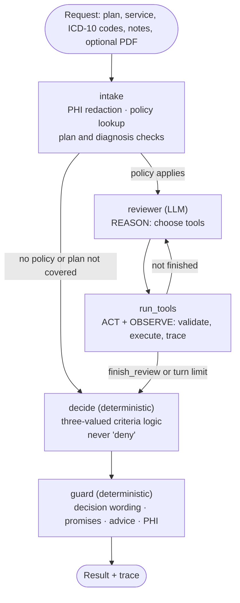

# Prior Authorization Review Agent

[](https://github.com/AlexisAJ-5/prior-auth-review-agent/actions/workflows/ci.yml)


An agentic copilot that **pre-reviews prior authorization requests** against payer medical policies.
It reads the clinical record, checks each policy criterion with cited evidence, and prepares the case
for a human reviewer. It recommends approval, asks for missing information, or routes the case to a
physician. **It never denies a request.**

> **Personal project.** I built it as a production-style proof of concept, with the practices I would
> apply on a client delivery: typed code, offline tests, CI, an evaluation harness, architecture
> decision records and documented trade-offs. All policies and patient cases are **synthetic**.
> Nothing here is medical advice or a real payer policy.

---

## Why this problem

Prior authorization is the step where a health plan checks a requested service (an MRI, a surgery,
a drug) against its medical policy before agreeing to pay. Reviewers spend most of that time
locating evidence in long clinical notes. Two constraints shape what an AI system may do there:

- **Deadlines.** Under the CMS Interoperability and Prior Authorization final rule (CMS-0057-F),
  impacted payers must decide within **72 hours** for expedited requests and **7 calendar days** for
  standard ones, from 2026.
- **Humans decide adverse outcomes.** California's SB 1120 (2024) requires that medical-necessity
  denials be made by a licensed clinician, not by an algorithm.

So this agent does the evidence work and leaves the judgment to people: it can only recommend
approval, request information or escalate. Every output carries its decision deadline.

## What it does



1. **Intake** redacts identifiers (names, dates, phone numbers, emails, record and member numbers,
   addresses, ages over 89) **before any model call**. Raw text is dropped from the graph state and
   never stored. It also checks that the policy applies to the plan and that a submitted ICD-10-CM
   code is listed.
2. **The reviewer agent** runs a ReAct loop with five tools:

   | Tool | What it does |
   |---|---|
   | `search_clinical_record` | Hybrid (dense + lexical) search over the redacted record, split into citable sentences (`N3`, `D1`). The record is **not** in the prompt: the agent has to look for evidence. |
   | `search_policy_guidelines` | RAG over the policy sections in Qdrant, filtered to the governing policy. |
   | `calculate_bmi` | Arithmetic is done by code, not by the model. |
   | `record_criterion` | Records `met`, `not_met` or `insufficient_evidence` for one criterion. It is refused if the cited sentences were never retrieved, or if `met`/`not_met` has no evidence. |
   | `finish_review` | Refused until every criterion is recorded and the cited policy sections were actually retrieved. |

   Each call carries a one-sentence `purpose`, logged in the trace, so the trace explains every
   action without exposing private chain of thought. Invalid calls come back as error
   observations and the agent corrects itself.
3. **Decide** evaluates the policy logic (for example `RF1 OR (C1 AND C2 AND C3)`) with three-valued
   logic, so missing evidence propagates as "unknown" instead of silently becoming "not met".
   *Met* → recommend approval. *Unknown* → request more information. *Not met*, unsupported
   diagnosis, unfinished run or plan mismatch → refer to physician review.
4. **Guard** scans every model-written field for adverse-decision wording, approval promises,
   treatment advice and leftover PHI. Failing text is replaced with a template built from the
   structured result, and the replacement is reported.

The browser UI (served by the API) shows the recommendation, each criterion with its quoted
evidence, the cited policy sections, the PHI redaction counts and the full agent trace.

## Key design decisions

| Decision | Why | Trade-off |
|---|---|---|
| One LLM agent between deterministic nodes ([ADR 0001](docs/adr/0001-single-agent-deterministic-gate.md)) | The model does what needs language understanding (finding and reading evidence). Code does what must be reproducible: logic, deadlines, safety rules. | Fewer "agents" on the diagram, but each LLM call earns its place. |
| No automated denials ([ADR 0002](docs/adr/0002-no-automated-denials.md)) | Regulation and patient safety. Errors in this system cost reviewer time, never a wrongly refused treatment. | Every non-approval needs a human. |
| PHI redaction before the model ([ADR 0003](docs/adr/0003-phi-redaction-before-llm.md)) | Minimum necessary data leaves the boundary; logs and the database only hold redacted text. | Rule-based redaction misses some identifiers (see limitations). |
| Evidence the agent must retrieve and cite ([ADR 0004](docs/adr/0004-retrieval-design.md)) | Citations are checked by code against what was actually returned, so an assessment cannot cite a sentence that does not exist. | More tool calls than putting the whole note in the prompt. |
| Provider switch by configuration ([ADR 0005](docs/adr/0005-provider-agnostic-llm.md)) | Gemini through its native LangChain client; Ollama, OpenAI and other servers through the OpenAI-compatible client. Runs on a free Gemini key or fully local. | Two client libraries to keep up to date. |
| LangGraph with an explicit graph | The ReAct cycle and the routing are visible and testable node by node. | One more dependency than a hand-written loop. |
| Qdrant + FastEmbed `bge-small-en-v1.5` (ONNX, CPU) | Free, local, no second API key; the model is baked into the Docker image. Qdrant runs in-memory for tests and evaluation. | A small general-purpose embedder; a clinical one may rank better. |

## Quick start

You need an LLM: a free [Gemini API key](https://aistudio.google.com/apikey), or
[Ollama](https://ollama.com) running locally (no key).

```bash
cp .env.example .env   # then set LLM_API_KEY (or switch to Ollama)
```

**With Docker** (Qdrant + API):

```bash
docker compose up --build -d --wait
# open http://localhost:8000, pick a synthetic example, run the pre-review
```

**Without Docker** (in-memory Qdrant), with [uv](https://docs.astral.sh/uv/):

```bash
uv sync
uv run uvicorn prior_auth.api:app --reload    # http://localhost:8000
```

The `Makefile` wraps these commands (`make help`). On Windows without `make`, run the `uv` and
`docker compose` commands directly.

## API

Interactive docs at `http://localhost:8000/docs`.

| Method | Path | Description |
|---|---|---|
| `POST` | `/v1/reviews` | Multipart form: `plan_id`, `service_code`, `diagnosis_codes` (comma-separated), `urgency`, `clinical_notes`, optional `document_text` and `document` (PDF). Returns the review. |
| `GET` | `/v1/reviews/{id}` | A stored review. |
| `GET` | `/v1/reviews/{id}/trace` | Every graph step and tool call: purpose, input, observation, timing, token usage. |
| `GET` | `/v1/policies` | Policies, criteria and approval logic. |
| `GET` | `/v1/examples` | The synthetic cases, for the UI. |
| `GET` | `/health`, `/ready` | Liveness; readiness (policies indexed and an LLM configured). |

Errors: `422` invalid input (unknown service, malformed ICD-10 code), `400` unreadable PDF,
`413` file too large, `502` provider failure or rate limit, `503` no LLM configured.

## Evaluation

`evals/cases/` holds 16 labelled synthetic requests across the five policies, with the expected
status of every criterion and the expected recommendation. A unit test checks that each label set
is consistent with the decision rules, so the labels and the logic cannot drift apart.

```bash
uv run prior-auth-eval --delay 4     # writes evals/results/latest.md and latest.json (git-ignored)
```

Reported metrics:

- **Recommendation accuracy** and the confusion matrix.
- **False approvals** (approved when the label says otherwise): the error that matters most for a payer.
- **Missed approvals**: cases sent to a human unnecessarily (workload, not harm).
- **Criterion accuracy** and recall per status.
- **PHI leaks**: every identifier in the raw input is searched for in the result and the trace. The target is 0.
- Guard replacements, completion rate, latency, tool calls and tokens per review.

Free-tier quotas are small, so use `--delay` and `--only PA-001,PA-007` to iterate on a subset.
Transient errors (rate limit, overload) are retried with backoff; an exhausted daily quota stops
the run early instead of burning retries.

### Results (Gemini 3.5 Flash-Lite, free tier)

The prompt was iterated against this evaluation. Every run is kept in `evals/results/`.

| Version | Change | Recommendations | Criteria | `not_met` recall | `insufficient_evidence` recall |
|---|---|---|---|---|---|
| v1 | Baseline prompt | 14/16 (87.5%) | 92.3% | 1.00 | 0.20 |
| **v2 (shipped)** | **Prompt: absence of evidence is not evidence of absence** | **15/16 (93.8%)** | **98.1%** | **1.00** | **0.80** |
| v3 | + tool challenges `not_met` rationales that describe missing information | 16/16 (100%) | 94.2% | 0.80 | 1.00 |
| v4 | + prompt exception for evidence the policy rejects | 15/16 (93.8%) | 90.4% | 0.67 | 1.00 |

Across all runs: **0 false approvals, 0 PHI leaks, 0 guard replacements**, about 9 tool calls and
5 seconds (median, excluding rate-limit waits) per review.

**What the iterations showed.**

- v1's main error: when the record was silent on a criterion, the model often marked it `not_met`.
  That sends the case to a physician instead of asking for documents.
- v2 fixed most of it with one rule in the prompt.
- v3 fixed the last case (PA-016), but per-criterion accuracy dropped. The challenge also flipped
  correct `not_met` assessments where the record does mention the topic, but with evidence the
  policy rejects ("patient feels better" where objective measures are required). Recommendations
  stayed right only because other criteria already failed in those cases.
- v4 tried to carve out that exception and made `not_met` recall worse.
- **v2 is shipped.** It has the best per-criterion accuracy, and its one remaining error (PA-016,
  "PT tried, duration not documented", sent to a physician instead of a documents request) fails
  on the safe side.

**Caveats.** These are 16 synthetic cases with one run per version, so a difference of one case
is within run-to-run variance. The labels are mine. The numbers show the method and the failure
modes, not production accuracy.

## Quality

```bash
uv run pytest            # 85+ offline tests: no network, no API key (a scripted model drives the graph)
uv run ruff check . && uv run ruff format --check .
uv run mypy              # strict
```

The tests cover PHI redaction, the three-valued logic and decision rules, tool validation and the
agent's self-correction, the turn limit, the guard, the API (including PDF upload) and an
end-to-end check that **no identifier reaches the model or the stored outputs**. CI runs lint,
types, tests with coverage, and the Docker build. Pre-commit hooks run ruff and mypy locally
(`uv run pre-commit install`).

## Project layout

```
src/prior_auth/
  api.py            FastAPI routes + static UI
  service.py        composition root: builds components, runs and stores a review
  graph.py          LangGraph wiring: intake -> reviewer <-> run_tools -> decide -> guard
  reviewer.py       agent system prompt and opening message
  tools.py          tool schemas, validation and per-review context
  record.py         redacted record split into citable sentences, hybrid search
  knowledge_base.py Qdrant index of policy sections
  determination.py  three-valued criteria logic, decision rules, CMS deadlines
  guard.py          deterministic output checks and template fallback
  phi.py            PHI redaction
  policies.py       policy models and loading
  evaluation.py     evaluation CLI (prior-auth-eval)
data/policies/      five synthetic medical policies (criteria, logic, guideline sections)
evals/cases/        sixteen labelled synthetic requests
tests/              offline test suite
docs/adr/           architecture decision records
```

## Limitations and next steps

- **PHI redaction is rule-based.** It catches labelled names, dates, contact details and record
  numbers, but not an unlabelled name in free text or a city. Next: a clinical NER model (for
  example Presidio with a medical recognizer) in front of the rules.
- **Synthetic, small policy set.** Five policies and sixteen cases show the method; they do not
  measure real-world accuracy. Next: more cases per policy, adversarial cases (prompt injection in
  notes, contradictory documents) and inter-annotator agreement on labels.
- **Scanned PDFs are not read** (text layer only). Next: OCR, or page images sent to a vision model.
- **Guard rules are regexes.** They are cheap and predictable but can over-trigger. Next: calibrate
  them on a labelled set and add an LLM reviewer for tone.
- **No authentication, rate limiting or audit log export.** Required before any real deployment,
  along with encryption at rest and a BAA with the model provider.
- **Single-node SQLite.** A shared deployment would use Postgres and a queue for long reviews.
- **Observability.** Token usage is in the trace; next is OpenTelemetry spans per node and tool.

## How this was built

See [AI_USAGE.md](AI_USAGE.md) for how AI coding tools were used and [CLAUDE.md](CLAUDE.md) for the
conventions an AI coding agent must follow in this repository.

## License

MIT. Policies, cases and identifiers are fictional; any resemblance to real people is coincidental.
ICD-10-CM codes are used for illustration and the code lists are not authoritative.
